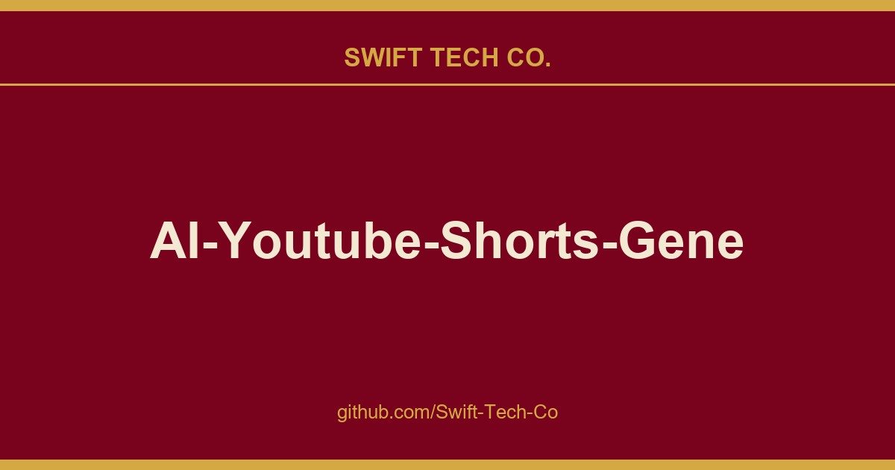

# AI-Youtube-Shorts-Generator

## What This Is

This is part of the Swift Tech Co. working stack for product and engineering. It gathers the AI-Youtube-Shorts-Generator notes, examples and fixes that keep delivery fast, and doubles as the reference map we hand to whoever picks up this thread next.

## Images

[](https://github.com/Swift-Tech-Co)

## ✨ Key Features

- **🧠 Intelligent Scriptwriting:** Uses **Google Gemini 2.0 Flash** to write engaging, "Edutainment" style scripts (Vox/Kurzgesagt style) with strict storytelling structures (Hook → Context → Mechanism → Twist).
- **🗣️ Voiceovers:** Generates narration with `edge-tts`.
- **🎞️ Dual-Visual System:** Automatically searches and downloads **two distinct stock videos** per scene from **Pexels**, creating a dynamic "A/B Split" visual style to maximize viewer retention.
- **✂️ Advanced FFmpeg Editing:**
- **Smart Trimming:** Syncs video perfectly to audio duration.
- **A/B Splitting:** Cuts every scene in half, switching visuals mid-sentence.
- **Pro Transitions:** Randomly applies `xfade` (fade, slide, wipes) between scenes.
- **Silence Removal:** Automatically trims dead air from AI voice generation.

- **🤖 Random Avatar Injection:** Automatically inserts a custom "Avatar/Mascot" video into a random middle scene to build channel brand identity.
- **🪟 Windows Ready:** Includes specific FFmpeg flags (`yuv420p`, `faststart`) to prevent corruption errors (`0x80004005`) on Windows Media Player.

---

## 📂 Project Structure

```text
Automated-YT-Shorts-AI/
│
├── assets/                  # Stores all media files
│   ├── audio_clips/         # Generated voiceovers (.wav)
│   ├── video_clips/         # Downloaded stock footage (.mp4)
│   ├── temp/                # Intermediate processing files
│   ├── final/               # 🏆 The Final Output Video lives here
│   └── avatar/              # ⚠️ PUT YOUR AVATAR VIDEO HERE
│       └── Professional_Girl_Animation_Video_Generation.mp4
│
├── modules/                 # Core Logic Modules
│   ├── brain.py             # AI Scriptwriter (Gemini)
│   ├── audio.py             # Voice generator (edge-tts)
│   ├── asset_manager.py     # Pexels Downloader (Dual-Visual logic)
│   └── composer.py          # FFmpeg Video Editor (Stitching & Transitions)
│
├── main.py                  # Entry point (Orchestrator)
└── requirements.txt         # Python dependencies

```

---

## 🛠️ Prerequisites

1. **Python 3.10+** installed.
2. **FFmpeg** installed and added to your system PATH.

- _Windows:_ `winget install ffmpeg` (or download from ffmpeg.org).
- _Verify:_ Type `ffmpeg -version` in your terminal.

3. **API Keys:**

- **Google Gemini API Key** (Free tier available).
- **Pexels API Key** (Free).
- No Ngrok token is required for the default voiceover path. The current pipeline uses `edge-tts`.

---

## 🚀 Installation

### 1. Clone the Repository

```bash
git clone https://swifttechco.com
cd AutoShorts-AI

```

### 2. Install Dependencies

```bash
pip install -r requirements.txt

```

### 3. Environment Setup

Create the required folders and add your avatar:

1. Create folder: `assets/avatar`
2. Place your avatar video inside and name it: `avatars.mp4`

### 4. Configure API Keys

Copy `.env.example` to `.env` and fill in your key:

```bash
cp .env.example .env
```

Required:

- `GEMINI_API_KEY` for script generation
- `PEXELS_API_KEY` for stock video search/download

Optional:

- `GEMINI_MODEL` to override the default `gemini-2.0-flash` model

---

## 🎮 How to Run

### Generate Video

Run the main script:

```bash
python main.py

```

1. Enter a topic (e.g., _"The Mystery of the Pyramids"_).
2. Wait for the AI to write the script, generate audio, download stock footage, and edit the video.
3. The final video will be saved in `assets/final/final_short.mp4`.

---

## 🧩 Module Breakdown

### `brain.py` ( The Writer)

- **Input:** Topic string.
- **Logic:** Prompts Gemini to create an 8-9 scene JSON script. It asks for **two** visual keywords per scene (`visual_1`, `visual_2`) to enable the A/B split effect.

### `audio.py` (The Voice)

- **Input:** Text script.
- **Logic:** Generates MP3 voice clips with `edge-tts`.
- **Post-Processing:** Reads durations with `mutagen` so scenes can be synced to audio length.

### `asset_manager.py` (The Librarian)

- **Input:** Visual keywords.
- **Logic:** Searches Pexels for **Portrait (9:16)** videos. Downloads pairs of videos for every scene. Handles fallbacks (if Video B is missing, reuse Video A).

### `composer.py` (The Editor)

- **Input:** Audio files + Video files.
- **Logic:**
- **Scene Processing:** Cuts the scene duration in half. Plays Video A for the first half, Video B for the second half.
- **Avatar Injection:** Identifies a random "middle" scene (not hook/outro) and replaces the stock footage with your Avatar loop.
- **Stitching:** Merges all scenes using `xfade` transitions (wipes, slides).
- **Rendering:** Exports as `yuv420p` H.264 MP4 with `faststart` flags for maximum compatibility.

---

## ⚠️ Troubleshooting

**Q: The video is black or corrupt (0x80004005 error).**

- **Fix:** This is usually a Windows codec issue. The updated `composer.py` forces `pix_fmt='yuv420p'`. Try opening the file with VLC Media Player.

**Q: "Avatar file missing" error.**

- **Fix:** Ensure your folder structure is exactly `assets/avatar/avatars.mp4`.

**Q: The audio is silent or fails.**

- **Fix:** Check your internet connection and that `edge-tts` is installed from `requirements.txt`.

**Q: FFmpeg error "Exec format error" or "not found".**

- **Fix:** Ensure FFmpeg is installed and accessible from your command line.

---

## 📜 License

This project is open-source. Feel free to modify and build your own automation empire!

---

## Swift Tech Co.

Built and maintained by Swift Tech Co.

AI Automation | FinTech Platforms | Custom Software and Mobile Apps | SaaS Platforms | Cloud Infrastructure | Cybersecurity | SEO and Marketing | API Integration

**Join our community on Telegram:** [t.me/+Qt_eFvkb2rliMzNh](https://t.me/+Qt_eFvkb2rliMzNh)

Home | Services | Careers | Referral Program | Influencers | About | Contact

**Connect**

- Website: swifttechco.com
- LinkedIn: [linkedin.com/in/stephenoladoke](https://www.linkedin.com/in/stephenoladoke/)
- LinkedIn (Company): [linkedin.com/company/swift-tech-co](https://www.linkedin.com/company/swift-tech-co)
- X: [@MrOladoke](https://x.com/MrOladoke)
- Instagram: [@mr.oladoke](https://www.instagram.com/mr.oladoke/)
- Instagram (Company): [@swifttechco](https://www.instagram.com/swifttechco/)
- Organization: [github.com/Swift-Tech-Co](https://github.com/Swift-Tech-Co)

## Sources

Compiled and maintained from upstream [Anil-matcha/AI-Youtube-Shorts-Generator](https://github.com/Anil-matcha/AI-Youtube-Shorts-Generator) under permissive open-source license.

---

Maintained by [Swift Tech Co.](https://github.com/Swift-Tech-Co) - [Telegram](https://t.me/+Qt_eFvkb2rliMzNh)

## Sources

Compiled and maintained from upstream [Anil-matcha/AI-Youtube-Shorts-Generator](https://github.com/Anil-matcha/AI-Youtube-Shorts-Generator) under permissive open-source license.

---

Maintained by [Swift Tech Co.](https://github.com/Swift-Tech-Co) - [Telegram](https://t.me/+Qt_eFvkb2rliMzNh)